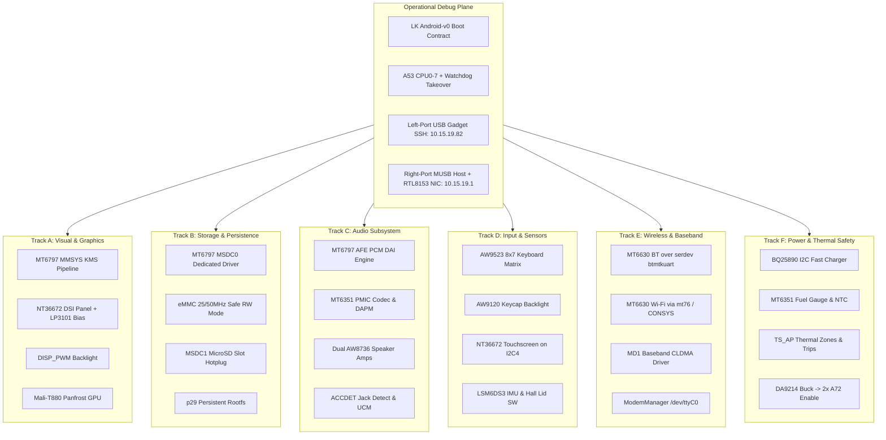

# Mainline Campaign: Planet Computers Gemini PDA (MT6797)

## 1. Executive Summary & Concurrent Workstream Model

Hardware bring-up does not have to be a slow, monolithic waterfall. Once the basic diagnostic plane is operational (which we already have via the **USB Gadget Dropbear SSH** link at `10.15.19.82` and the **Right-Port USB 1.1 Host with RTL8152/8153 Gigabit Ethernet** at `10.15.19.1`), the remaining platform components can be tackled across **6 completely parallel workstreams**.

---

## 2. Resolved Hardware Unknowns Matrix

Before writing any new driver code, all critical hardware ambiguities have been resolved directly from the vendor BSP kernel (`/home/grw/src/gemini-linux-kernel-3.18`), device tree sources, and verified register dumps:

| Domain | Previously Unknown | Resolved Hardware Truth & Exact Configuration | Citation / Register / Pin |
| :--- | :--- | :--- | :--- |
| **LCD Bias Power** | How are $\pm 5.5\text{V}$ panel rails powered? | **LP3101 / TPS65132** on `I2C0` (Addr `0x3E`). Reg 0x00 = `0x0F` (+5.5V), Reg 0x01 = `0x0F` (-5.5V). | GPIO 60 (`bias_enp`), GPIO 251 (`bias_enn`) |
| **LCD Reset** | Which GPIO resets the DSI panel? | Dedicated MMSYS register **`DISP_REG_CONFIG_MMSYS_LCM_RST_B`** at `0x14000150`. | MMSYS `0x14000150` |
| **Backlight** | Is backlight on an I2C LED driver? | **No.** Backlight is driven directly by hardware **`DISP_PWM`** at `0x1100f000`. | `DISP_PWM` `0x1100f000` |
| **Speaker Amps** | How are stereo speakers amplified? | **Dual Awinic AW8736** Class-G amps with 1-wire pulse control (Mode 3: 0.8W). | Left: `GPIO243`, Right: `GPIO244` |
| **Headphone HP** | How is headphone pop/click prevented? | External HP switch (`GPIO234`) and CS line (`GPIO235`) + MT6351 -1.6V NCP. | `GPIO234`, `GPIO235` |
| **Jack Detection** | Which IRQ handles 3.5mm jack & buttons? | MT6351 PMIC **`EINT6`** (256ms debounce) + AuxADC Ch 1 (<90mV = Hook/Play). | PMIC `EINT6` |
| **Touchscreen Bus** | Which bus and address for touch? | Novatek NT36672 on **`I2C4` (`0x11011000`)** at slave address **`0x62`**. | `GPIO85` (EINT 8), `GPIO68` (RST) |
| **Keyboard Matrix**| What is the exact matrix key wiring? | AW9523 at `0x58` scanning **8 Rows (P0_0..P0_7)** $\times$ **7 Cols (P1_0..P1_6)**. | `GPIO87` (EINT 10), `GPIO58` (RST) |
| **Lid Switch** | How is typing in pocket prevented? | Hall sensor on **`GPIO66`** (`SW_LID`) signals notifier to suspend AW9523. | `GPIO66` (`SW_LID`) |
| **Sensors Bus** | Where are the IMU, ALS/PS, and Baro? | All on **`I2C1` (`0x11008000`)**: LSM6DS3 (`0x6A`), STK3X1X (`0x48`), BMP280 (`0x77`). | `GPIO65` (Gyro), `GPIO88` (ALS) |
| **A72 Buck PMIC** | How is the dual Cortex-A72 powered? | External **Dialog DA9214** buck on **`I2C6` APPM (`0x1100e000`)** at address **`0x68`**. | `GPIO61` (Pinctrl) |
| **GPU Buck PMIC** | How is the Mali-T880 powered? | External **Fairchild FAN53555** on **`I2C7` GPUPM (`0x11010000`)** at address **`0x60`**. | `VGPU` 0.6V–1.3V |
| **Charger IC** | Which fast charger and address? | **TI BQ25890** on **`I2C0` (`0x11007000`)** at address **`0x6B`** (up to 3.25A input). | `I2C0` `0x6B` |
| **Cellular Modem** | Where is baseband DRAM located? | Fixed 161 MiB reserved DRAM window at `0x40000000`–`0x80000000`. | CCIF `0x10209000`, CLDMA `0x10014000` |

---

## 3. Parallel Execution Roadmap

### Track A: Display & Graphics (Visual Plane)
- **Goal:** Enable Wayland compositor (Sway / Phosh) on the native $1080\times 2160$ panel with full 3D acceleration.
- **Tasks in Parallel:**
  1. Add MT6797 MMSYS routing table to `drivers/gpu/drm/mediatek/mtk_drm_drv.c`.
  2. Implement `drivers/gpu/drm/panel/panel-novatek-nt36672.c` with LP3101 I2C regulator + GPIOs 60 & 251.
  3. Bind `pwm-backlight` to MediaTek `DISP_PWM` (`0x1100f000`).
  4. Enable `CONFIG_DRM_PANFROST=y` and add `gpu@13040000` to DTS.

### Track B: Storage & System Persistence
- **Goal:** Replace read-only initramfs SquashFS loop with native read-write root on eMMC partition `p29`.
- **Tasks in Parallel:**
  1. Fix MT6797 dedicated block-length handling in `drivers/mmc/host/mtk-sd.c`.
  2. Set conservative 25 MHz / 50 MHz 8-bit DDR timing mode in `&mmc0`.
  3. Add `&mmc1` MicroSD slot node with card-detect GPIO and `vmc`/`vmch` PMIC rails.

### Track C: Audio Routing & ALSA UCM
- **Goal:** Enable stereo internal speakers, 3.5mm TRRS headset output/input, and internal microphones.
- **Tasks in Parallel:**
  1. Implement `sound/soc/mediatek/mt6797/mt6797-afe.c` DAI platform driver (`0x11220000`).
  2. Implement `sound/soc/codecs/mt6351.c` regmap codec driver.
  3. Wire dual AW8736 speaker amplifiers on GPIO 243 and GPIO 244.
  4. Build `/etc/alsa/ucm2/Planet-Gemini-PDA/` HiFi profile.

### Track D: User Input & Environmental Sensors
- **Goal:** Native mechanical keyboard typing, multi-touch gestures, auto-brightness, and orientation sensing.
- **Tasks in Parallel:**
  1. Define 8x7 matrix keymap in `gpio-matrix-keypad` attached to AW9523 on `I2C5` (`0x58`).
  2. Configure Novatek NT36672 touch controller on `I2C4` (`0x62`, IRQ `GPIO85`).
  3. Enable upstream `st_lsm6dsx` (IMU) and `stk3310` (ALS/PS) on `I2C1`.
  4. Add Hall sensor (`GPIO66` `SW_LID`) to `gpio-keys`.

### Track E: Wireless Connectivity & Baseband
- **Goal:** Native Bluetooth, Wi-Fi 802.11ac networking, and 4G LTE cellular data.
- **Tasks in Parallel:**
  1. Wire Bluetooth over `serdev` using upstream `btmtkuart`.
  2. Implement native WMT patch downloader daemon or MT6630 `mt76` driver.
  3. Implement Linux WWAN CLDMA driver for MT6797 MD1 baseband.
  4. Configure ModemManager on `/dev/ttyC0`.

### Track F: Power, Battery & Thermal Safety
- **Goal:** Safe 3.25A fast charging, battery percentage fuel gauge telemetry, and enabling the dual Cortex-A72 cores.
- **Tasks in Parallel:**
  1. Bind TI BQ25890 charger driver on `I2C0` (`0x6B`).
  2. Configure MT6351 Coulomb counter and NTC thermistor temperature curves.
  3. Setup TS_AP thermal zones and cooling trip points (75°C passive, 85°C A72 hotplug).
  4. Add Dialog DA9214 (`I2C6` `0x68`) regulator node and enable CPUs 8–9 (`maxcpus=10`).

---

## 4. Master Chapter Directory

- **[01. Display & DRM/KMS Subsystem](file:///home/grw/src/nixos-gemini/campaign/01-display-drm-kms.md)**
- **[02. GPU & 3D Acceleration (Mali-T880 / Panfrost)](file:///home/grw/src/nixos-gemini/campaign/02-gpu-panfrost.md)**
- **[03. Touchscreen Subsystem (Novatek NT36672)](file:///home/grw/src/nixos-gemini/campaign/03-touchscreen.md)**
- **[04. Audio Subsystem (AFE, MT6351 Codec, Dual AW8736 Amps)](file:///home/grw/src/nixos-gemini/campaign/04-audio-routing-codecs.md)**
- **[05. Wi-Fi, Bluetooth & FM Radio (CONSYS / MT6630)](file:///home/grw/src/nixos-gemini/campaign/05-wifi-bluetooth.md)**
- **[06. Cellular Modem & Baseband (CLDMA / CCIF / MD1)](file:///home/grw/src/nixos-gemini/campaign/06-cellular-modem.md)**
- **[07. Sensors & Co-Processor (LSM6DS3, ALS/PS, SCP)](file:///home/grw/src/nixos-gemini/campaign/07-sensors-and-coprocessor.md)**
- **[08. Power Management, PMIC, Battery & DVFS](file:///home/grw/src/nixos-gemini/campaign/08-power-pmic-battery-dvfs.md)**
- **[09. USB Subsystem, Type-C & Power Delivery](file:///home/grw/src/nixos-gemini/campaign/09-usb-typec-power-delivery.md)**
- **[10. Camera & Imaging Subsystem (ISP / MIPI CSI)](file:///home/grw/src/nixos-gemini/campaign/10-camera-isp.md)**
- **[11. Storage Subsystem (eMMC 5.1 & MicroSD)](file:///home/grw/src/nixos-gemini/campaign/11-storage-emmc-sdcard.md)**
- **[12. Keyboard Matrix & Notification LEDs](file:///home/grw/src/nixos-gemini/campaign/12-keyboard-and-leds.md)**
- **[13. GPS & GNSS Subsystem (CONSYS GNSS / MNL / A-GPS)](file:///home/grw/src/nixos-gemini/campaign/13-gps-gnss.md)**
